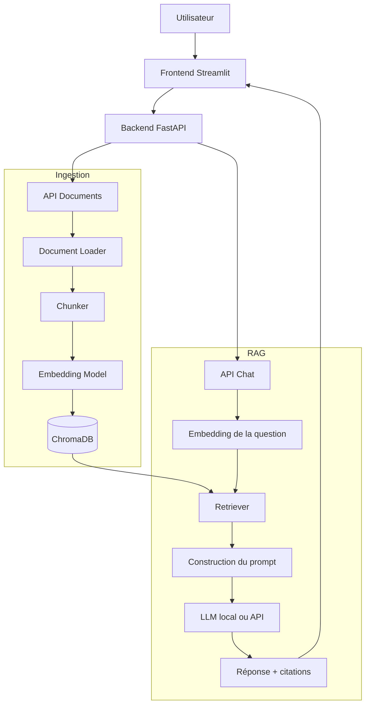

# Personal RAG System — Architecture du projet

> Dépôt : [salmaizou/personal-rag-system](https://github.com/salmaizou/personal-rag-system)

## 1. Objectif

Développer un assistant IA capable de répondre aux questions d'un utilisateur à partir de ses documents personnels (`PDF`, `DOCX`, `TXT`), en citant les sources utilisées.

Le projet est organisé autour de deux pipelines :

- **Ingestion** : lire les documents, extraire et découper le texte, calculer les embeddings et indexer les chunks.
- **RAG** : recevoir une question, rechercher les passages pertinents, construire un contexte et générer une réponse avec des références aux sources.

## 2. Architecture globale



### 2.1 Pipeline d'ingestion

1. L'utilisateur importe un document depuis l'interface.
2. `loader.py` extrait le texte et conserve les métadonnées (nom du fichier, page si disponible).
3. `chunker.py` découpe le texte en segments avec un chevauchement configurable.
4. `embeddings.py` transforme les segments en vecteurs.
5. `vector_store.py` enregistre vecteurs, chunks et métadonnées dans ChromaDB.

### 2.2 Pipeline de question-réponse

1. L'utilisateur pose une question.
2. La question est convertie en vecteur avec le **même modèle d'embeddings** que les documents.
3. `retriever.py` récupère les `top-k` chunks les plus pertinents.
4. `rag_pipeline.py` assemble les passages retrouvés dans un prompt.
5. `llm.py` appelle le modèle de langage pour produire une réponse appuyée sur le contexte.
6. L'application affiche la réponse et les références aux documents/pages disponibles.

> Le modèle doit pouvoir indiquer que l'information n'a pas été trouvée dans les documents, plutôt que d'inventer une réponse.

## 3. Arborescence initiale

```text
personal-rag-system/
├── app/
│   ├── __init__.py
│   ├── main.py
│   ├── api/
│   │   ├── __init__.py
│   │   ├── documents.py
│   │   └── chat.py
│   ├── core/
│   │   ├── __init__.py
│   │   └── config.py
│   ├── ingestion/
│   │   ├── __init__.py
│   │   ├── loader.py
│   │   ├── chunker.py
│   │   └── embeddings.py
│   ├── retrieval/
│   │   ├── __init__.py
│   │   ├── vector_store.py
│   │   └── retriever.py
│   └── generation/
│       ├── __init__.py
│       ├── llm.py
│       └── rag_pipeline.py
├── frontend/
│   └── streamlit_app.py
├── data/
│   ├── documents/
│   └── chroma_db/
├── tests/
│   ├── test_chunker.py
│   └── test_retriever.py
├── .env.example
├── .gitignore
├── requirements.txt
└── README.md
```

## 4. Rôle des fichiers

| Fichier | Responsabilité |
| --- | --- |
| `app/main.py` | Créer l'application FastAPI et enregistrer les routes. |
| `app/api/documents.py` | Endpoint d'import et de traitement des documents. |
| `app/api/chat.py` | Endpoint de questions/réponses. |
| `app/core/config.py` | Configuration : chemins, modèle, chunk size, top-k, etc. |
| `app/ingestion/loader.py` | Extraction du texte et des métadonnées des fichiers. |
| `app/ingestion/chunker.py` | Découpage du texte en chunks. |
| `app/ingestion/embeddings.py` | Encodage des textes et questions en vecteurs. |
| `app/retrieval/vector_store.py` | Stockage et interrogation de ChromaDB. |
| `app/retrieval/retriever.py` | Recherche des passages pertinents. |
| `app/generation/llm.py` | Interface vers le LLM (Ollama ou API). |
| `app/generation/rag_pipeline.py` | Orchestration de la récupération, du prompt et de la génération. |
| `frontend/streamlit_app.py` | Interface d'importation et de chat. |
| `tests/` | Tests unitaires et d'intégration. |
| `.env.example` | Exemple des paramètres d'environnement, sans secrets. |
| `.gitignore` | Ignore environnements virtuels, secrets et documents personnels. |
| `requirements.txt` | Dépendances Python. |

## 5. Technologies du MVP

| Composant | Choix initial |
| --- | --- |
| Langage | Python |
| API | FastAPI |
| Frontend | Streamlit |
| Embeddings | Sentence Transformers |
| Base vectorielle | ChromaDB |
| LLM | Ollama en local ou une API de modèle |
| Tests | Pytest |

**Principe :** construire d'abord les mécanismes principaux sans framework RAG haut niveau, pour comprendre chaque étape. On pourra ensuite intégrer des outils supplémentaires si leur utilité est démontrée.

## 6. Exemple de fonctionnement

Document importé : `cours_reseaux.pdf`

```text
Chunk 1 : « Un réseau LAN couvre généralement une zone géographique limitée… »
Chunk 2 : « Un réseau WAN relie des réseaux sur de grandes distances… »
Chunk 3 : « La commutation de paquets permet de partager une liaison… »
```

Question : **« Quelle est la différence entre LAN et WAN ? »**

Le retriever sélectionne les chunks 1 et 2. Le LLM répond à partir de ces extraits, avec une référence du type `cours_reseaux.pdf — page 3` si cette métadonnée est disponible.

## 7. API minimale prévue

| Méthode | Endpoint | Fonction |
| --- | --- | --- |
| `GET` | `/health` | Vérifier que le backend répond. |
| `POST` | `/documents` | Importer et indexer un document. |
| `POST` | `/chat` | Poser une question et obtenir une réponse sourcée. |

Ces routes sont **prévues**, pas encore implémentées.

## 8. Feuille de route

- [ ] **Phase 1 — Initialisation :** dossiers, environnement Python, dépendances, FastAPI et `/health`.
- [ ] **Phase 2 — Ingestion :** chargement PDF/TXT/DOCX, extraction, métadonnées et chunking.
- [ ] **Phase 3 — Indexation :** embeddings et stockage ChromaDB.
- [ ] **Phase 4 — Recherche :** top-k, score de similarité et récupération de sources.
- [ ] **Phase 5 — Génération :** connexion LLM et pipeline RAG complet.
- [ ] **Phase 6 — Interface :** upload des documents, chat et affichage des citations.
- [ ] **Phase 7 — Qualité :** tests, cas sans réponse, évaluation retrieval et réponses.

## 9. Améliorations futures

- Recherche hybride (dense + BM25).
- Reranking des chunks.
- Historique de conversation.
- Gestion multi-utilisateur et isolation stricte des documents.
- Déduplication et mise à jour des documents indexés.
- Streaming des réponses.
- Évaluation : Recall@K, MRR, précision des citations et qualité des réponses.
- Déploiement avec Docker.

## 10. Sécurité et confidentialité

- Ne jamais committer `.env`, les clés API, les données de ChromaDB ou les documents personnels.
- Valider le type et la taille des fichiers importés.
- Traiter le contenu des documents comme **données non fiables**, pas comme instructions au modèle.
- Si des comptes utilisateurs sont ajoutés, contrôler l'accès aux documents **côté serveur** et filtrer les recherches par utilisateur.

---

**Première étape concrète :** créer l'arborescence et faire fonctionner le serveur FastAPI avec `GET /health`.
